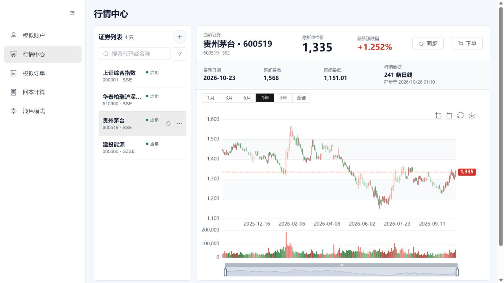

# 预览行情范围补充

日期：2026-10-26。

用户发现三只验证标的只有5条日线。原因是之前真实接口smoke显式限定2026-10-19至23五个交易日，并非接口上限。普通“同步”按最新本地日期之后做增量，因此不会自动补齐更早历史。

本次只对独立预览实例 `.runtime/v13-live-preview-20261025` 的三只标的执行显式日期范围2025-10-26至2026-10-26的同步。已有记录按日期更新，没有清空数据库、账户、订单或持仓，没有修改应用源码或生成安装包。

| 标的 | 原条数 | 新增 | 已有更新 | 补齐后条数 |
| --- | ---: | ---: | ---: | ---: |
| 上证综合指数 | 5 | 236 | 5 | 241 |
| 华泰柏瑞沪深300ETF | 5 | 236 | 5 | 241 |
| 贵州茅台 | 5 | 236 | 5 | 241 |

三只实际交易日期均为2025-10-27至2026-10-23，共241条。UI刷新后已显示241条并绘制一年K线。更早的阶段验证记录仍保留5条样例的历史事实，本文件记录补齐后的当前预览状态。

