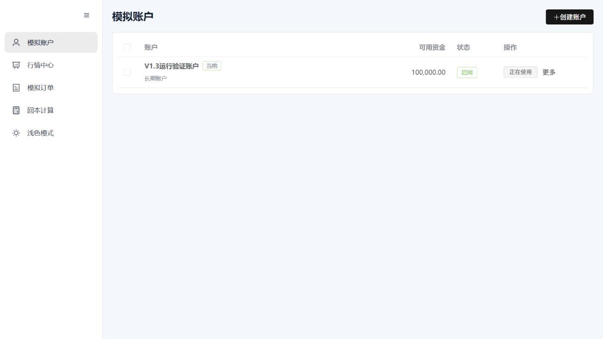
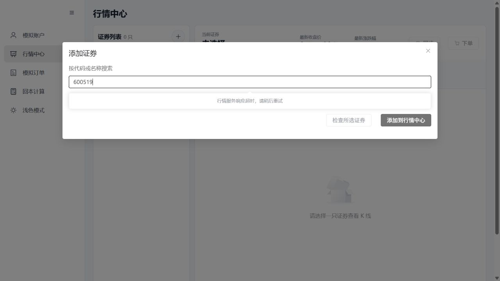

# V1.3 第一阶段实际运行检查

检查跨 2026-10-25 至 2026-10-26（Asia/Shanghai）。检查代码：`bcec5d1`。用户在本次会话中明确允许推送，并要求展示软件能否正常运行。

## 结论

应用能启动，前端、Java 后端、Python 服务和 H2 连接正常。通过实际界面创建了模拟账户，默认组合自动生成，刷新后仍能读取。

真实搜索 `600519` 出现“行情服务响应超时，请稍后重试”。因此本次只确认启动和基本读写，不能宣称全部行情功能正常。该问题作为阶段 B 的真实复现入口。

## 运行方式与隔离

- 使用现有 Vue/Vite、打包后的 Spring Boot JAR、Python `app.cli` 入口运行；后端启用 desktop Profile，数据库为 H2 File。
- 这是源码运行预览，不是 Tauri 原生窗口，也不是 Windows 安装包验证；未构建或安装新的安装包。
- 前端：<http://127.0.0.1:5173/accounts>；后端：127.0.0.1:8080；Python：127.0.0.1:8001。三个服务仅使用本机地址。
- 使用全新独立目录 `D:\2\QuantGuard\.runtime\v13-live-preview-20261025`，不访问 `%APPDATA%\QuantGuard` 正式数据库。
- 自动同步保持关闭；未导入证券、未触发历史日线回填，没有删除任何用户数据。
- 本机 JDK 临时 socket 路径问题仍存在，预览启动也显式使用 `-Djdk.net.unixdomain.tmpdir=D:\2\QuantGuard\.runtime\v13-test-tmp`；没有修改生产默认参数。
- Python 使用本次 Codex 会话 work/python-env 的独立依赖环境；前端依赖来自既有锁文件。

## 实际操作与结果

| 操作 | 结果 |
| --- | --- |
| Python `/health` | HTTP 200 |
| Java `/api/health` | success=true，status=running |
| Java `/api/database/health` | success=true，status=connected |
| 浏览器打开行情中心、账户页面 | 正常加载，无需模拟 API |
| 通过 UI 创建“V1.3运行验证账户”，初始模拟资金 100,000 | 页面显示创建成功，API 返回 ACTIVE 账户和 100,000 可用资金 |
| 查询组合 | 自动生成“默认组合” |
| 刷新账户页面 | 仍显示已创建账户，读取真实 H2 实例 |
| H2 文件检查 | `data/quantguard.mv.db` 已写入，检查时为 61,440 字节；未复制运行中的数据库 |
| 实际 UI 搜索 600519 | 显示“行情服务响应超时，请稍后重试”；不是 mock 结果 |

没有执行真实交易；这里的账户和资金完全属于本地模拟系统。本次未额外创建模拟订单，也未对当前预览实例做进程重启持久化测试；阶段 A 的 6 条桌面/H2 自动测试已通过。

## 运行截图

账户创建并刷新后的实际页面：



真实证券搜索超时：



## 服务管理

为方便用户继续查看，本次结束时保留三个服务和可交互页面。日志位于上述独立目录的 `logs/`；服务 PID 和启动时间记录在 `runtime/dev-processes.json`。不要通过名称批量结束其他 Java/Python 进程。

需要停止本次预览时，从仓库根目录执行已有停止脚本，明确传入同一隔离目录：

```powershell
.\scripts\stop-dev.ps1 -Desktop -DataDirectory 'D:\2\QuantGuard\.runtime\v13-live-preview-20261025'
```

该脚本按记录的 PID/启动时间清理对应进程树，不删除 H2 数据。直接关闭浏览器不会自动停止后台服务。

## GitHub 备份

用户已授权将本阶段代码、任务交接和进度文档推送到 `origin/refactor/v1.3-stability`。首次推送完成后，`git ls-remote` 核对远端指向 `bcec5d12967cddb71be7547c42ccf00e063a3a96`。

本报告及两张截图随之后的记录提交一起推送；main 不修改、不合并。ZIP/Git bundle 仍作为本地独立恢复包，不重复提交回仓库。

下一步先修复阶段 B 的真实目录/行情调用可靠性，再分别验证普通 A 股、ETF 和指数。不能用已通过的离线测试替代真实接口证据。
