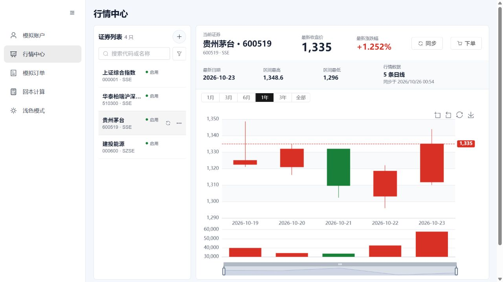

# V1.3 C：精简与冗余切除

日期：2026-10-26。分支：`refactor/v1.3-stability`。用户最新要求是先完成精简，不急于打包。本轮没有生成新的安装包或自包含运行时。

## 已删除或合并

- 删除 ConfiguredMarketDataProvider：只剩 Python 实现，不再保留单一目标的整层转发和 Provider 选择配置。保留 MarketDataProvider 抽象、PythonMarketDataProvider、Python HTTP 错误和超时处理。
- 删除上述已移除组件的3条专属测试，保留和运行真实 Provider/HTTP、业务、H2与调度器回归；没有删除或跳过失败用例。Java用例总数因此从178变为175。
- 删除从未被调用的 batchSize/batch-size 配置，以及 YAML、启动脚本和 Tauri 中无效的 MARKET_DATA_PROVIDER 设置。
- BaoStock 三处登录/登出合并为会话管理；删除重复TCP预探测，实际SDK调用继续受工作进程硬截止控制。AKShare三处相同日线frame/异常校验合并，保留各源实际调用和归一化规则。
- Element Plus只注册实际模板用到的组件；子组件直接按名称注册，避免部分install为空导致的回归。各页面改为路由懒加载，保留旧URL重定向以兼容已有入口。
- 运行依赖与测试依赖分离：requirements.txt只放运行项，pytest/httpx移到requirements-test.txt，构建工具仍在requirements-build.txt；既有CI、发布脚本与README同步调整，未运行发布脚本。
- PyInstaller资源收集取消额外复制.py源文件，排除测试框架；保留MiniRacer DLL、ICU与运行所需资源。这里验证的是收集清单，不把它当作已验证的安装包体积。
- 修复后台Vite在继承stdin关闭后退出：仅托管的前端进程设置CI=true。已有脚本语法检查与实际后台运行通过，未修改全局系统设置。

## 实测体积

| 项目 | 精简前 | 精简后 | 说明 |
| --- | ---: | ---: | --- |
| 前端全部JS（未gzip） | 1,792,455 B | 1,374,773 B | 减少23.3%；不是只比较入口文件 |
| 最大JS块 | 1,777,202 B | 643,153 B | 页面按需加载；图表块仍较大，未隐藏Vite警告 |
| Python重复数据收集 | 471份源文件 | 不再重复收集 | 原始大小合计3,832,824 B；不是压缩后安装包节省值 |

首次目录统计：前端约300MB中约297MB是被Git忽略的node_modules，源码约0.19MB；Git对象约2MB。没有通过删除运行依赖、构建验证证据或用户数据来制造体积下降。

## 日志增长治理

| 日志 | 每个活动文件 | 备份/归档策略 |
| --- | ---: | --- |
| backend.out/err、market-data.out/err | 各2MiB | 各保留2个备份，4个流合计最多24MiB |
| desktop-runtime.log | 1MiB | 2个备份，合计3MiB |
| Python结构化日志 | 5MiB | 3个备份，约20MiB预算 |
| Spring Boot文件日志 | 5MB | 7天历史，归档总量50MB上限，另有活动文件 |

进程输出通过固定缓冲区持续读取并轮转，不再让子进程直接append到无限增长的文件；停止时回收日志线程。旧超大日志仅对这几个指定日志文件保留末尾到限额，数据库目录不参与清理。不能把H2数据增长视为垃圾，本轮不压缩、不清空、不替换用户数据库。

无法写盘时继续排空进程输出管道，防止服务被满管道阻塞。子进程加入Windows Job Object失败时会清理已启动的进程，避免孤儿进程。

## 验证

| 检查 | 结果 |
| --- | --- |
| Java源码 clean test | 175通过，0失败/错误/跳过，含6条既有桌面/H2和失败日志重启持久化测试 |
| Python离线 | 38通过；6条live明确排除 |
| 显式真实网络 | 6通过，约30秒；沪深股票、两个ETF、指数、冷启动搜索 |
| Vue类型/lint/资源编译 | 通过，保留图表大chunk提示 |
| 前端E2E | 9通过；曾发现子组件注册问题，已修复，测试未跳过 |
| 原生日志模块Windows测试 | 4通过，覆盖超大写入、旧日志收尾、重启续写、数据库哨兵不受影响 |
| Rust格式和完整源码 cargo check --locked --all-targets | Windows CI通过；只做源码验证，禁用该检查的打包资源 |
| 依赖文件 | pip dry-run通过，运行/测试/构建依赖入口同步 |
| 启动脚本 | PowerShell语法校验通过，后台Vite和源码后端实际启动 |

原生源码验证：[Windows source-checks](https://github.com/THESuiseiCOMET/QuantGuard/actions/runs/40213357569/job/121229138655)，验证源码提交b556912；后续适配器去重不改变该Rust源码。

## 实际完整行情链路

在独立 `.runtime/v13-live-preview-20261025` 数据目录，以源码方式启动Java/Python/Vue。通过实际Java接口搜索、导入/更新证券，再显式同步2026-10-19至23；未创建订单、未删除已有账户、订单或持仓。原预览中用户添加的证券保留。

| 标的 | 搜索耗时秒 | 同步耗时秒 | 实际查询到的H2日线条数 |
| --- | ---: | ---: | ---: |
| 600519.SH | 1.406 | 0.844 | 5 |
| 510300.SH | 0.843 | 2.437 | 5 |
| 000001.SH | 13.094 | 2.547 | 5 |

上述样例均SUCCESS；这是本机本次真实请求结果，不保证上游永久可用。指数冷搜索仍比普通股票慢，但有硬超时和补充目录缓存。截图为实际H2行情数据，非mock：

## 文件清单

M修改、D删除、A新增。下表自阶段B提交c3fc17d之后统计；另外新增本报告、验证JSON和截图，并更新进度与README。

| 类型 | 路径 |
| --- | --- |
| M | `.github/workflows/market-data-python-ci.yml` |
| M | `.github/workflows/windows-desktop-ci.yml` |
| M | `.github/workflows/windows-runtime-ci.yml` |
| M | `README.md` |
| M | `docs/V1.3_PROGRESS.md` |
| M | `quant-guard-backend/README.md` |
| M | `quant-guard-backend/src/main/java/com/vanyiung/quantguard/marketdata/config/MarketDataProperties.java` |
| D | `quant-guard-backend/src/main/java/com/vanyiung/quantguard/marketdata/provider/ConfiguredMarketDataProvider.java` |
| M | `quant-guard-backend/src/main/resources/application-desktop.yaml` |
| M | `quant-guard-backend/src/main/resources/application-local.example.yaml` |
| M | `quant-guard-backend/src/main/resources/application.yaml` |
| D | `quant-guard-backend/src/test/java/com/vanyiung/quantguard/marketdata/provider/ConfiguredMarketDataProviderTest.java` |
| M | `quant-guard-frontend/src-tauri/src/lib.rs` |
| A | `quant-guard-frontend/src-tauri/src/rotating_log.rs` |
| M | `quant-guard-frontend/src-tauri/src/runtime.rs` |
| M | `quant-guard-frontend/src/main.ts` |
| M | `quant-guard-frontend/src/router/index.ts` |
| M | `quant-guard-market-data-python/README.md` |
| M | `quant-guard-market-data-python/app/clients.py` |
| M | `quant-guard-market-data-python/app/logging_config.py` |
| M | `quant-guard-market-data-python/quantguard-market-data.spec` |
| M | `quant-guard-market-data-python/requirements.txt` |
| M | `quant-guard-market-data-python/tests/test_clients.py` |
| M | `scripts/build-windows-release.ps1` |
| M | `scripts/start-dev.ps1` |
| M | `scripts/test-desktop-runtimes.ps1` |

## 当前边界与恢复

- 精简源码与现有功能回归已完成；Windows安装包、自包含运行时和打包后生命周期验证按用户要求暂停，没有将源码检查冒充安装包验收。
- refactor分支保留Java/Python/Vue/Rust源码CI，Windows打包job跳过；此前已触发的打包run已取消。main未修改或合并。
- 仍使用原有构建流程，未新增发布方式；将来恢复打包时需显式恢复refactor分支打包gate或使用原release流程，并验证PyInstaller多进程入口。
- 数据目录自定义入口、停机备份/安全迁移仍属于后续D，不在本轮已完成范围。
- 本机JDK socket临时路径参数仍用于源码预览；正式环境的默认行为未改。服务保留运行，日志和PID在独立预览目录，停止可使用原stop-dev脚本传入该目录。
